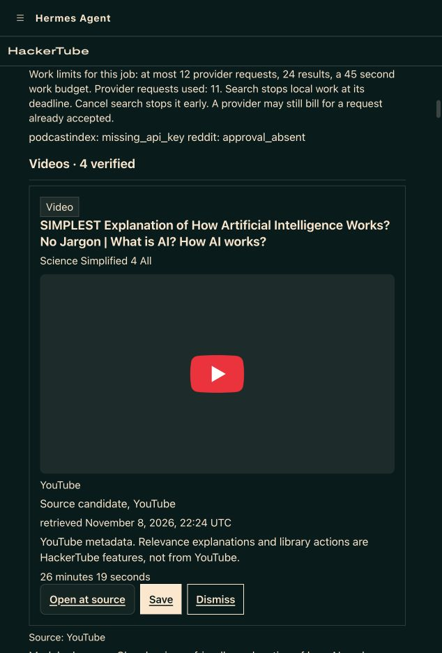
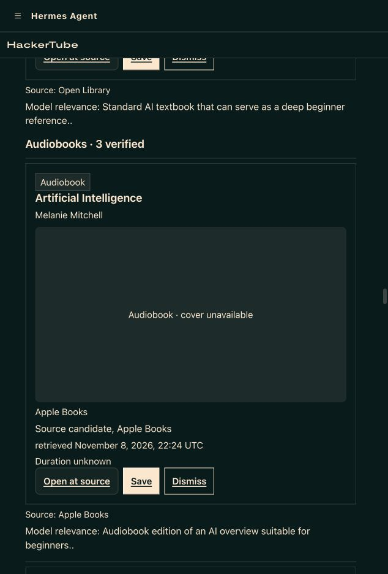

Published as https://github.com/NousResearch/hermes-agent/pull/151535 .

## What does this PR do?

Add one community/web catalog entry for [HackerTube for Hermes](https://github.com/rcmiller01/hackertube), version **0.2.2**, exact pin `3e65af3b424bb932de944731340d99122f0a67ed`, subdirectory `hackertube`. The submitting account owns the plugin repository. This independent implementation is inspired by Andrej Karpathy’s HackerTube; About/README/listing credit his original idea. It is not a fork of a listed plugin. No duplicate catalog entry, PR or issue was found.

The dashboard discovers source-backed videos, podcasts, books and audiobooks using an existing configured Hermes model, with a profile-local library and original-source links. This PR changes only `plugin-catalog/hackertube.yaml`; no Hermes core behavior changes.

## Surfaces and disclosures

Uses public `ctx.register_auxiliary_task`, `ctx.register_cli_command`, `ctx.llm`, `ctx.dispatch_tool`, unload callbacks, dashboard plugin routes, public model assignment/configuration and profile plugin storage. No plugin-owned model key or direct credential-store read. Optional source credentials/contact are declared in `config_schema` and obtained through Hermes `get_secret`. No self-updater, native binary, telemetry, unrelated chat history, memory request, player or media download.

Explicit Search sends the question/topic and bounded source metadata to the configured model/web-search service and enabled catalog APIs (HN/Algolia, Apple Search, Open Library, LibriVox, optional YouTube/Podcast Index). Browser cover hotlinks and user-opened sources contact their original hosts. Questions, job results/usage, normalized metadata, library flags, interests, source choices and source-open history persist in the serving profile. Versioned privacy agreement precedes features; credit acknowledgement is separate. Privacy provides local deletion/revocation after active Search is cancelled; host credentials and externally held data are independent.

An explicit Search launches a supervised Hermes CLI worker process group plus a watchdog, bounded to 45 seconds including startup, 12 logical dispatches and 24 results. Cancel stops/reaps owned work; interrupted jobs do not automatically resume. Already accepted remote processing/billing may continue and missing cost remains unknown. An hourly **local-only** retention thread runs while Hermes is active and stops on unload; no background network refresh. Stopped Hermes cannot delete files until it resumes; cleanup precedes access and exported backups are operator-managed. Successful YouTube hydration invalidates superseded stored copies; saved flags remain independent. The official embedded source icon retains Google’s branding terms, separate from the code’s MIT license. Open Library registration was submitted and confirmed recorded; provider approval is not asserted.

macOS is verified; Linux support follows the POSIX process-group path but integration is unrun. Windows is excluded in catalog `platforms`. Optional Podcast Index is not live-tested; Reddit remains disabled pending approval. Partial rankings and empty categories remain possible. The documented prior partial take omitted videos; no broad relevance guarantee or community-endorsement corpus is claimed.

## Validation and working demo

- Unauthenticated HTTPS clone at the exact pin, four immutable public gallery images and bundled public privacy policy: **pass**.
- `hermes plugins validate <exact-public-clone>/hackertube --install-deps`: **pass, 0 warnings**.
- Catalog structural validation across **1,205 catalog files**: pass. `python scripts/check`: **15 checks pass**.
- Reviewed plugin implementation: **309 Python / 83 Node+Chromium checks pass**, 0 failures/skips; exact installed payload matches **39/39 files**.
- [Actual working demo on X](https://x.com/RobertMiller34/status/2119561239160644023), tagging @NousResearch: **23.25 seconds**, uncut six-step recording with the full live Search wait, **4 videos / 4 podcasts / 5 books / 3 audiobooks**, 11/12 logical requests, unknown cost, Save, matching Apple Books source, and Karpathy credit. [Full exact-build receipt and disclosed retakes](https://github.com/rcmiller01/hackertube/blob/3776106fafe492e36565050812152ad9c8ed9524/docs/receipts/final-demo/README.md).

No Hermes core test suite was rerun for this one-file catalog-data addition; dedicated catalog validation, native source validation and repository guards are the relevant checks. No new runtime/test/CI files are included.

## Screenshots

## Related issue / change type

New community catalog listing; no linked issue. Feature/catalog data only. MIT licensing authority and solo submission confirmed by the owner. Catalog maintainer review/CI remains the admission gate.
